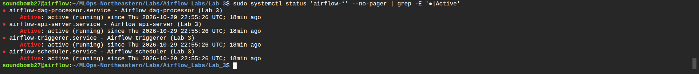
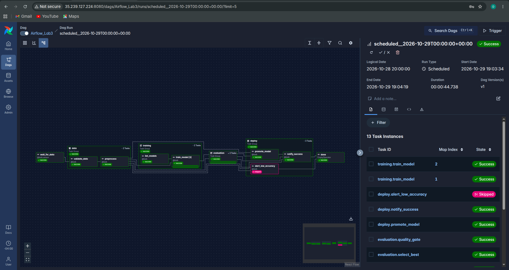
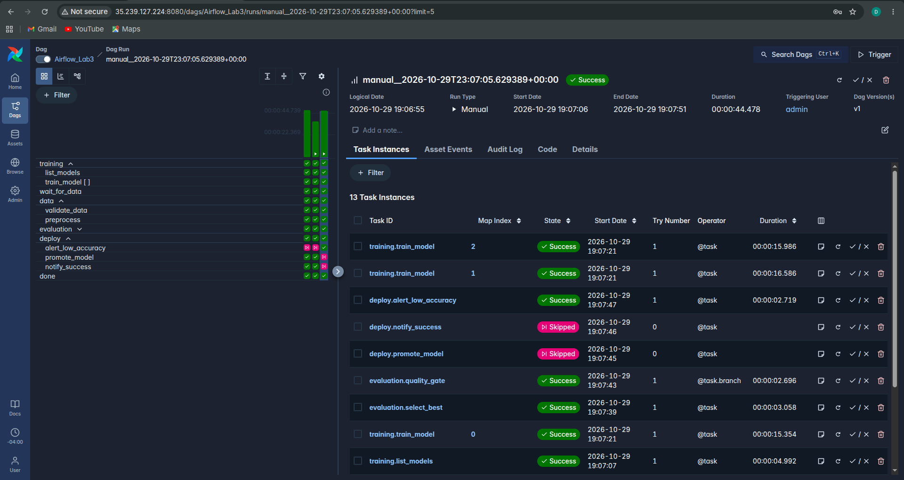
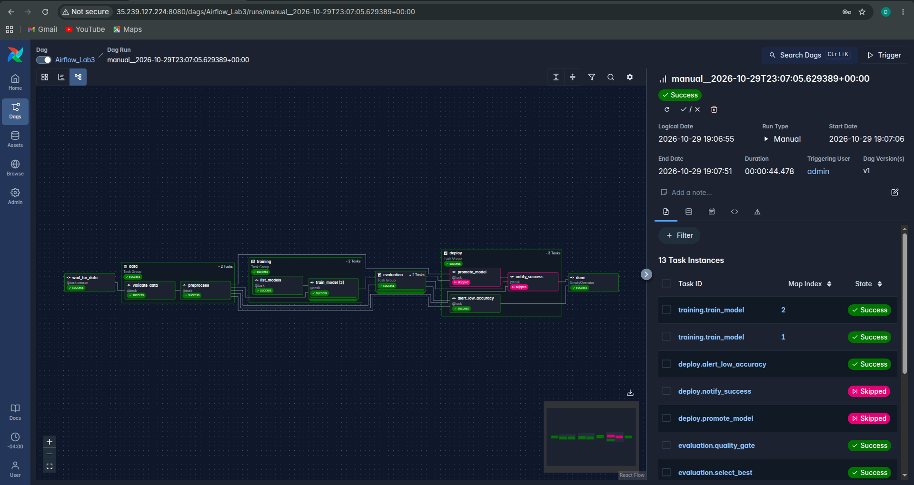

# Airflow Lab 3: ML Pipeline on a Cloud VM (Airflow 3)

An Airflow 3 DAG on a cloud VM that trains three ad-click models in parallel, promotes the best
one only if it passes an accuracy check, and emails a report.

## Pipeline

```
wait_for_data ─► validate_data ─► preprocess ─► train_model ×3 (parallel) ─► select_best ─► quality_gate
                                                                                              │
                                              accuracy ≥ threshold ─► promote_model ─► notify_success
                                              accuracy < threshold ─► alert_low_accuracy
```

## Key Changes (vs. original lab)

| # | Change | Why |
|---|--------|-----|
| 1 | **Rewritten for Airflow 3** with the TaskFlow API (`@dag`, `@task`, `@task_group`) | The original used Airflow 2 code that fails on Airflow 3. |
| 2 | **3 models trained in parallel** (Logistic Regression, Random Forest, Gradient Boosting) with **dynamic task mapping** | The original trained one model and never evaluated it. |
| 3 | **Quality gate** (`@task.branch`): the best model is promoted only if accuracy ≥ `accuracy_threshold`, otherwise an alert is sent | Only good models reach "production". |
| 4 | **Sensor + data validation** before training | The pipeline waits for the data and stops early on bad data. |
| 5 | **Retries with backoff, timeouts and a failure-alert email** on every task | Recovers from temporary errors and reports real failures. |
| 6 | **Run-time params** (`accuracy_threshold`, `test_size`, `models`, `notify_email`) | Runs are configured from the UI or API without editing code. |
| 7 | **One-command VM deployment** (`scripts/setup_vm.sh`) that runs Airflow as **4 systemd services** | Replaces the manual setup; the services restart on failure and survive reboots. |
| 8 | **REST API trigger** (`scripts/trigger_dag.sh`) using Airflow 3's `/api/v2` with JWT auth | The original API setup no longer exists in Airflow 3. |
| 9 | **Email fixed**: uses an Airflow SMTP connection and an HTML report | The original had a placeholder recipient and crashed on errors. |
| 10 | **12 pytest tests** for the DAG and the ML code | Catches broken DAGs before deploying. |
| 11 | **Tasks pass file paths through XCom**; each run's data splits and models are saved to `output/runs/<run_id>/` | Airflow 3 removed XCom pickling, and large objects don't belong in the metadata database. |
| 12 | **Model promotion with a model card**: the winner is copied to `output/production/` with `model_card.json` (metrics, threshold, source run) | A simple model registry that records what is deployed and where it came from. |
| 13 | **`metrics.json` report** for every run (accuracy, F1, precision, recall of each model) | Runs can be compared after the fact; the original only printed one score. |
| 14 | **Fixed `start_date` and a `@daily` schedule** with `catchup=False` and `max_active_runs=1` | `start_date=datetime.now()` is an Airflow anti-pattern; the DAG now also runs automatically. |
| 15 | **Data path relative to the repo** instead of `/home/mlops_fall_2024/advertising.csv` | The original path only existed on the author's VM. |
| 16 | **Task groups and DAG docs** (`data`, `training`, `evaluation`, `deploy`; `doc_md` shown in the UI) | A readable Graph view, with documentation next to the DAG. |
| 17 | **Gmail credentials stored as an Airflow connection** (`scripts/add_smtp_connection.sh`, password typed hidden) | Keeps secrets out of the code, the repo and `airflow.cfg`. |
| 18 | **Pinned, reproducible install** with Airflow's official constraints file, and generated secrets shared by all components | Same package versions on every VM; Airflow 3 components must share one JWT secret. |
| 19 | **Cleanup**: `.airflowignore` for helper folders, `.gitignore` for run outputs, removed the unused Flask `success.html`/`failure.html` | Faster DAG parsing and a clean repo. |

## How to Run

On an Ubuntu 24.04 VM with TCP port 8080 open:
```bash
git clone https://github.com/Divyam2701/MLOps-Northeastern.git
cd MLOps-Northeastern/Labs/Airflow_Labs/Lab_3
bash scripts/setup_vm.sh                 # prints the UI address and admin password
bash scripts/add_smtp_connection.sh      # optional: Gmail App Password for emails
```
Open `http://<VM-IP>:8080`, then unpause and trigger `Airflow_Lab3`. Set `accuracy_threshold`
to `0.99` to see the alert branch.

## Results

| Model | Accuracy | F1 |
|-------|----------|----|
| **logistic_regression** (promoted) | **0.9767** | 0.9764 |
| random_forest | 0.9700 | 0.9701 |
| gradient_boosting | 0.9600 | 0.9603 |

## Screenshots

### VM deployment: 4 systemd services
`setup_vm.sh` runs each Airflow 3 component as its own systemd service on the GCP VM.



### Graph view: promote run (scheduled by `@daily`)
This run was started automatically by the schedule. The best model passed the quality gate, so
`promote_model` and `notify_success` ran and `alert_low_accuracy` was skipped.



### Grid view: promote vs. alert runs, and parallel training
The first two runs promoted the model. The third run used `accuracy_threshold = 0.99`, so the
quality gate took the alert branch (`promote_model` and `notify_success` skipped). In the task
list, `train_model` map indexes 0, 1 and 2 all start at 19:07:21: the 3 models train in parallel.



### Graph view: alert run
All 13 task instances of the alert run, grouped into `data`, `training`, `evaluation` and `deploy`.


