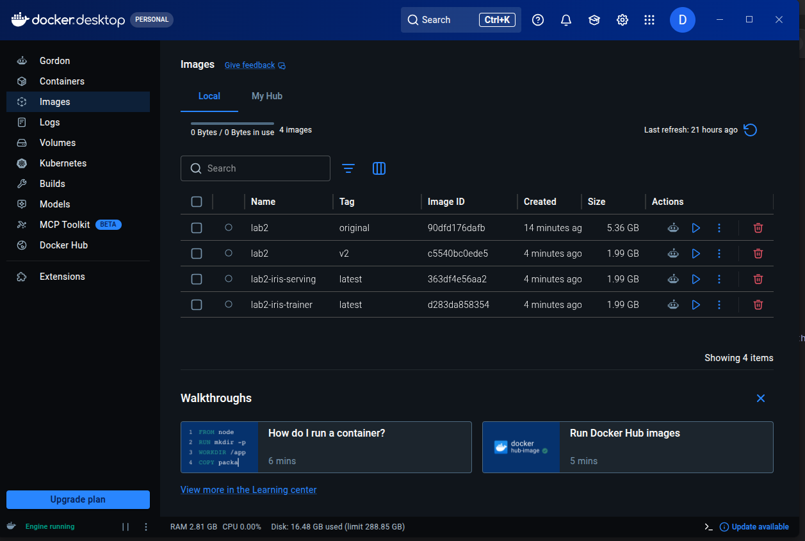
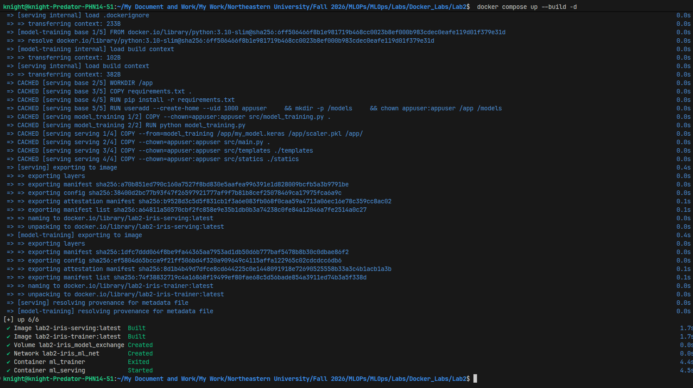
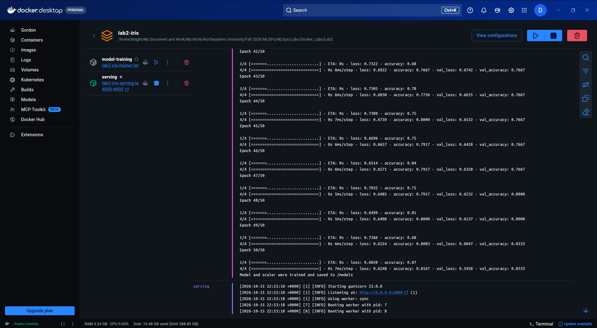
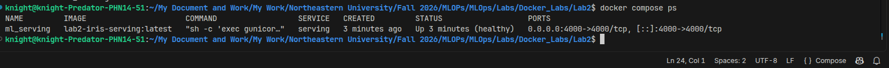
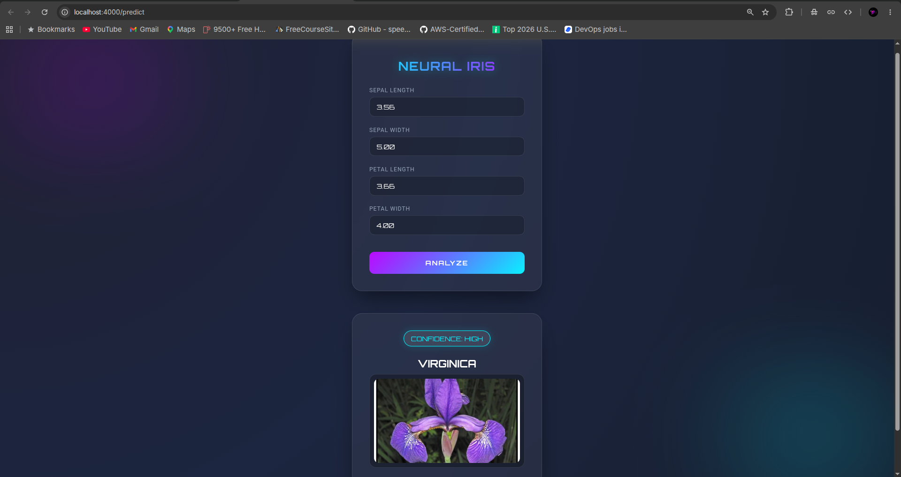
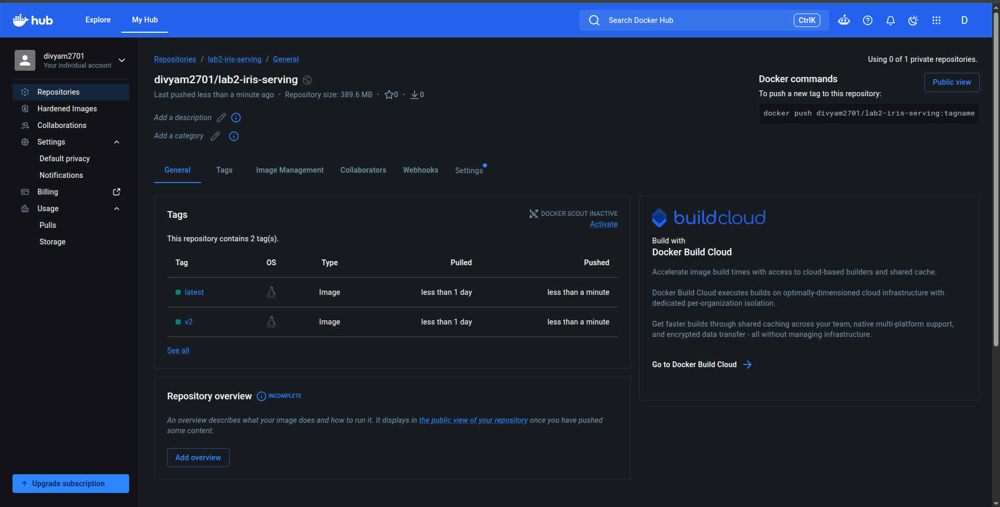

# Docker Lab 2 – Train & Serve an ML Model with Docker

This lab trains a TensorFlow classifier on the Iris dataset and serves it through a Flask web app, using:
- a **multi-stage Dockerfile** (shared dependency base → training stage → serving stage), and
- **Docker Compose** (a trainer service and a serving service that share the trained model through a named volume).

My modifications focus on the Docker side: smaller and more secure images, a production server,
health checks, configurable settings, and a Compose setup that builds its own images. See
[Changes Made](#changes-made-vs-original-lab).

## Project Structure

```
Lab2/
├── dockerfile            # multi-stage: base → model_training → serving
├── docker-compose.yml    # trainer + server, shared volume, healthcheck, limits
├── .dockerignore         # keeps the build context small
├── .env.example          # PORT / GUNICORN_WORKERS settings for compose
├── requirements.txt      # pinned dependency versions
├── screenshots/          # images used in this README
└── src/
    ├── model_training.py # trains the model, saves my_model.keras + scaler.pkl
    ├── main.py           # Flask app: /, /health, /predict
    ├── templates/predict.html
    └── statics/*.jpeg
```

## How to Run

### Quick start – pull from Docker Hub (no build needed)
The serving image is published at [`divyam2701/lab2-iris-serving`](https://hub.docker.com/r/divyam2701/lab2-iris-serving)
with the trained model already inside:
```bash
docker pull divyam2701/lab2-iris-serving:v2
docker run -d -p 4000:4000 --name lab2_app divyam2701/lab2-iris-serving:v2
```

### Option A – Dockerfile only
```bash
docker build -t lab2:v2 .
docker run -d -p 4000:4000 --name lab2_app lab2:v2
```
The model is trained during `docker build` (stage 1) and copied into the serving image (stage 2).

### Option B – Docker Compose (recommended)
```bash
cp .env.example .env        # optional, defaults are PORT=4000, GUNICORN_WORKERS=2
docker compose up --build
```
`ml_trainer` trains the model into the `model_exchange` volume and exits. `ml_serving` starts only
after training finishes successfully, then serves the model from the volume (mounted read-only).

### Try it
- http://localhost:4000/ – welcome message
- http://localhost:4000/health – health check (used by Docker)
- http://localhost:4000/predict – prediction form

```bash
curl -X POST -d "sepal_length=5.1&sepal_width=3.5&petal_length=1.4&petal_width=0.2" \
     http://localhost:4000/predict
# {"predicted_class":"Setosa"}
```

### Useful commands
```bash
docker ps                                          # STATUS shows (healthy)
docker inspect --format '{{.State.Health.Status}}' lab2_app
docker exec lab2_app whoami                        # appuser (not root)
docker compose ps -a                               # trainer Exited (0), serving Up (healthy)
docker compose logs -f serving
```

### Clean up
```bash
docker rm -f lab2_app          # Option A
docker compose down -v         # Option B (-v also removes the model volume)
```

## Changes Made (vs. original lab)

| # | File(s) | Change | Why |
|---|---------|--------|-----|
| 1 | `docker-compose.yml`, `dockerfile` | Port changed from `80` to `4000` (`EXPOSE` and port mapping) | The Flask app listens on 4000, so with the original `80:80` mapping the app could not be reached from the host. |
| 2 | `dockerfile` | Base image `python:3.10` → `python:3.10-slim`, `tensorflow` → `tensorflow-cpu`, pip `--no-cache-dir` | Image size dropped from **5.36 GB → 2.0 GB** (about 63% smaller). |
| 3 | `dockerfile` | New shared `base` stage that installs dependencies once; `requirements.txt` is copied before the source code | Dependencies are installed once instead of twice, and code changes no longer trigger a full reinstall (layer caching). |
| 4 | `.dockerignore` (new) | Excludes caches, model artifacts, `.git`, `.env`, docs | Smaller build context, and no local files end up inside the image by accident. |
| 5 | `dockerfile` | Container runs as a non-root user (`appuser`, UID 1000) | Security best practice: a compromised app doesn't get root inside the container. |
| 6 | `dockerfile`, `requirements.txt`, `src/main.py` | Serving uses **Gunicorn** instead of Flask's development server (`debug=True`) | Flask's built-in server isn't meant for production; Gunicorn supports multiple workers. |
| 7 | `src/main.py`, `dockerfile`, `docker-compose.yml` | New `/health` endpoint, Dockerfile `HEALTHCHECK` and Compose `healthcheck` | Docker can now tell whether the app is actually working (`healthy` / `unhealthy`), not only whether the process is running. |
| 8 | `dockerfile`, `docker-compose.yml`, `.env.example`, `src/*.py` | Port, worker count and model/scaler paths come from environment variables (`PORT`, `GUNICORN_WORKERS`, `MODEL_DIR`, `MODEL_PATH`, `SCALER_PATH`) | The same image can be configured without rebuilding (12-factor style). |
| 9 | `docker-compose.yml` | Compose **builds** images from the Dockerfile (`target: model_training` / `target: serving`) instead of running `pip install` in a plain `python` image on every start | Startup is fast and reproducible, and Compose and the Dockerfile share one definition. |
| 10 | `docker-compose.yml` | Model volume is mounted read-only in serving; added `restart: unless-stopped`, CPU/memory limits, a custom bridge network and a project name | Safer and more production-like setup for the service. |
| 11 | `requirements.txt` | All versions pinned; removed the unused `requests` | Reproducible builds: the same image every time. |
| 12 | `src/model_training.py`, `src/main.py` | `StandardScaler` is saved with the model (`scaler.pkl`) and applied at prediction time | The model was trained on scaled inputs but received raw values when serving, which gave wrong predictions. |
| 13 | Docker Hub | Serving image tagged and pushed to `divyam2701/lab2-iris-serving` (`v2`, `latest`) | Shares the image through a registry, so anyone can run the lab with one `docker pull`, without building it. |
| 14 | `HOWTO`, `README.md` | Updated run commands (the original `docker run app` had no `-p`) and added this README | Documentation. |

### Image size comparison

| Image | Size |
|-------|------|
| Original (`python:3.10`, full TensorFlow) | 5.36 GB |
| Modified (`python:3.10-slim`, `tensorflow-cpu`) | 2.0 GB |




`lab2-iris-serving` and `lab2-iris-trainer` are the two Compose images. They share the same `base`
stage layers, so on disk they take far less than 2 × 1.99 GB.

## Screenshots

### 1. `docker compose up --build -d`: layer caching in action
Running it again rebuilds both images in about 2 seconds. Every step, including `pip install`
and model training, shows `CACHED` because `requirements.txt` is copied before the source code
(change #3) and both services share the `base` stage. Compose creates the volume and network,
`ml_trainer` runs and exits, and then `ml_serving` starts.



### 2. Trainer → serving hand-off (Docker Desktop logs)
`model-training` trains for 50 epochs, saves `my_model.keras` and `scaler.pkl` to the shared
`/models` volume, and exits. `serving` then starts **Gunicorn 23.0.0** on port 4000 with
2 workers (`GUNICORN_WORKERS=2`), instead of Flask's development server.



### 3. `docker compose ps`: health check passing
`ml_serving` reports **(healthy)**. Docker calls the new `/health` endpoint every 30 s (change #7).
The container runs Gunicorn (`sh -c 'exec gunicorn ...'`) and publishes port `4000->4000`.



### 4. Prediction UI at `localhost:4000/predict`
The app is served from the container through the corrected `4000:4000` port mapping.



### 5. Image published on Docker Hub
`divyam2701/lab2-iris-serving` is a public repository with the `latest` and `v2` tags. Docker Hub
shows the **compressed** size (about 390 MB); it unpacks to the 1.99 GB shown by `docker images`.


